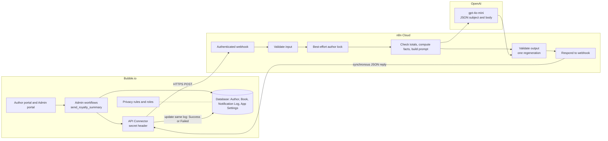
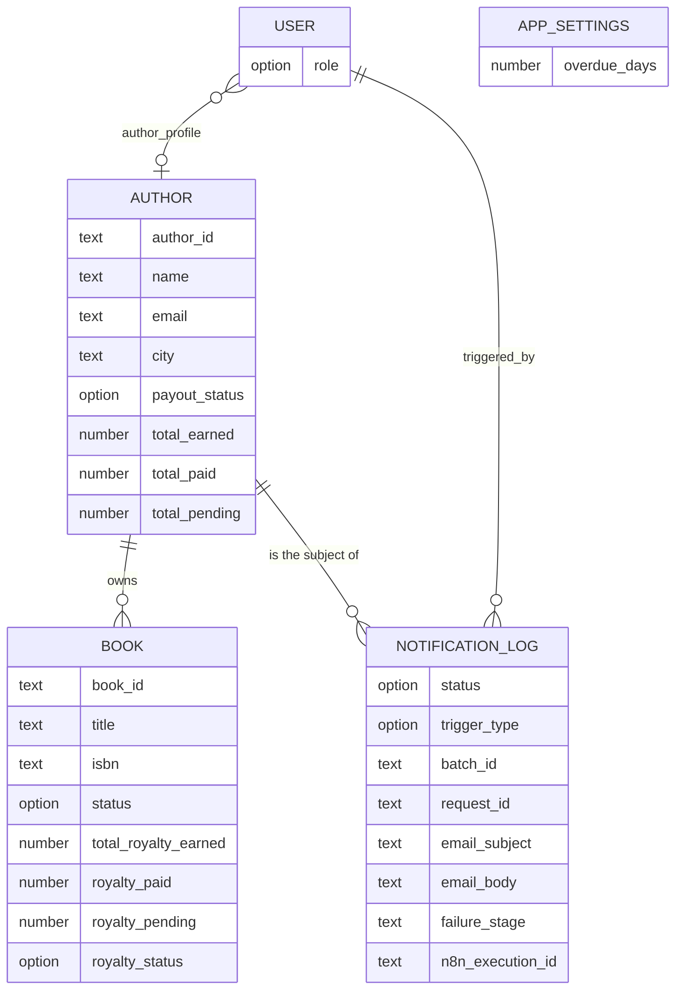
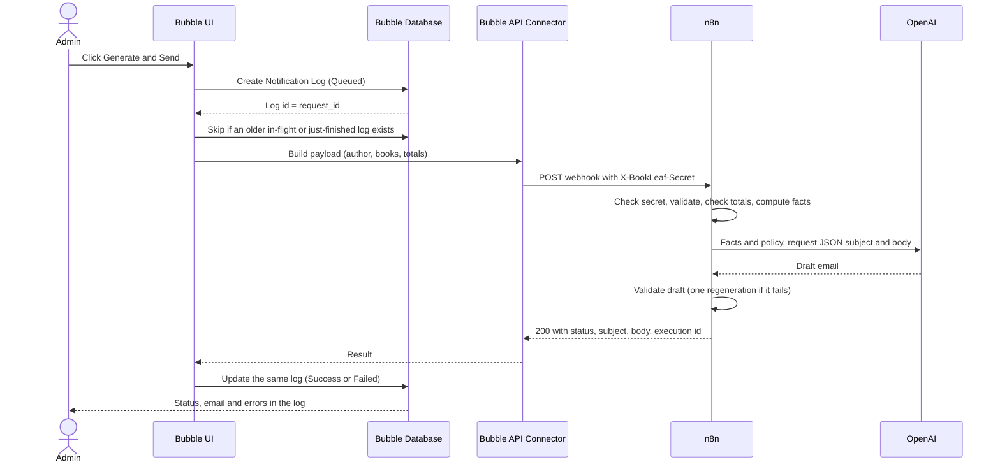
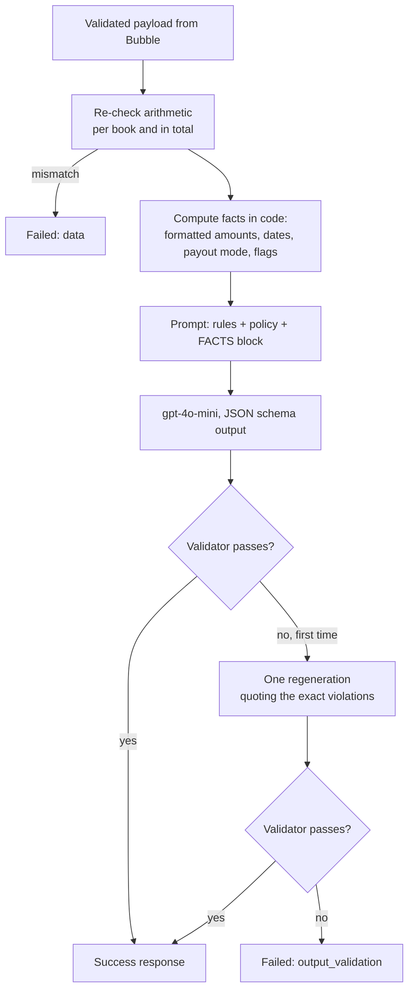
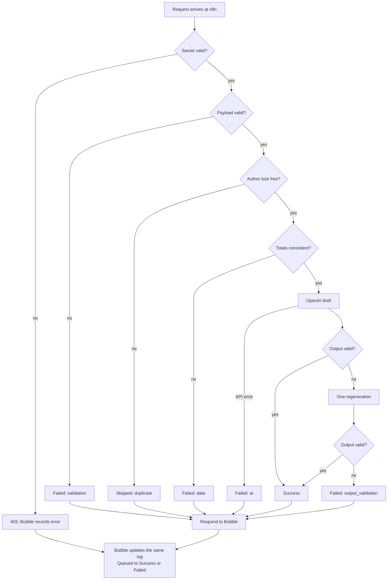
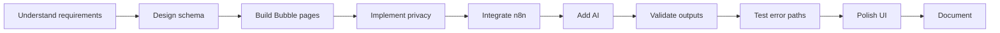

# BookLeaf — Author Royalty Dashboard & Automated Notification System

A no-code application and AI-powered workflow automation system built with Bubble.io, n8n and OpenAI.

Assignment 2 submission for BookLeaf Publishing. Authors log in and see their own books and royalties. Admins trigger an AI-written royalty summary for one author or many, and every request is recorded in a notification log.

| | |
|---|---|
| **Bubble application** | [https://mohitchaudhary2207.bubbleapps.io/version-test/](https://mohitchaudhary2207.bubbleapps.io/version-test/) |
| **Admin demo account** | `admin@bookleaf.com` / `author@123` |
| **Author demo account** | `priya.sharma@email.com` / `author@123` |
| **n8n workflow export** | [`n8n/export/bookleaf-royalty-summary.workflow.json`](n8n/export/bookleaf-royalty-summary.workflow.json) (credentials replaced with `REPLACE_ME`) |
| **n8n Code-node source** | [`n8n/code/`](n8n/code/) |
| **Screen recording** | [Watch on Google Drive](https://drive.google.com/file/d/1AsqqUmUkYc7IvFDkVhXYP4w617R_N7Z2/view?usp=sharing) |

> **Reading guide.** Part A describes the system as it is built today. Part B is the build journey: what was new to me, what went wrong, and what I changed.

## Table of contents

**Part A: The application**

1. [Project overview](#1-project-overview)
2. [Application at a glance](#2-application-at-a-glance)
3. [System architecture](#3-system-architecture)
4. [Bubble database schema and design decisions](#4-bubble-database-schema-and-design-decisions)
5. [Author portal](#5-author-portal)
6. [Admin portal](#6-admin-portal)
7. [Royalty calculation and business rules](#7-royalty-calculation-and-business-rules)
8. [Bubble and n8n integration](#8-bubble-and-n8n-integration)
9. [AI summary generation strategy](#9-ai-summary-generation-strategy)
10. [Error handling, validation and idempotency](#10-error-handling-validation-and-idempotency)
11. [Security and privacy](#11-security-and-privacy)
12. [Known limitations and trade-offs](#12-known-limitations-and-trade-offs)

**Part B: The build journey**

13. [My background and starting point](#13-my-background-and-starting-point)
14. [Learning Bubble in practice](#14-learning-bubble-in-practice)
15. [Real challenges I encountered](#15-real-challenges-i-encountered)
16. [My development approach](#16-my-development-approach)
17. [What I learned](#17-what-i-learned)
18. [Final reflection](#18-final-reflection)

---

# Part A: The application

## 1. Project overview

**The problem.** Authors want to know what they have earned, what has been paid and what is still pending. Without a portal they ask the operations team, who look the numbers up and write the same kind of email each time. That is slow, repetitive, and the wording varies from person to person.

**What this builds.**

| Author portal | Admin portal |
|---|---|
| Email and password login | Overview of all authors with totals |
| **My Books**: title, ISBN, genre, status, publication date, MRP, platforms | Search by name, filter by city and payout status |
| **Royalty Overview**: total earned, paid, pending, per-book figures and last payout | Author detail page with books and royalty figures |
| Green / amber / red status per book | **Generate & Send Royalty Summary** for one author |
| Only the author's own data | Bulk send for all authors with pending royalties, or for ticked authors |
| | Notification log with status, generated email and error details |

The admin clicks a button, Bubble hands the author's data to an n8n workflow, GPT-4o-mini writes the email, the workflow checks the result, and Bubble stores it. The outcome is a consistent, accurate summary for every author without anyone retyping figures.

> **Delivery.** The email is generated and stored in the Notification Log. No SMTP or email service is connected, so nothing is delivered to the author. The UI says "generated", not "sent". 

## 2. Application at a glance

| Component | Technology | Responsibility |
|---|---|---|
| Application, UI, auth | Bubble.io | Pages, login, roles, privacy rules, admin workflows |
| Database | Bubble database | Authors, books, notification log, settings |
| Bubble to n8n | Bubble API Connector | HTTPS POST with a secret header, reads the JSON reply |
| Automation | n8n Cloud | Webhook, validation, facts, prompt, OpenAI call, output validation, response |
| Language model | OpenAI `gpt-4o-mini` | Writes the subject and body from verified facts |

## 3. System architecture

The system has three parts. Bubble owns the data, the screens and the permissions. n8n owns the processing and the call to OpenAI. OpenAI only writes wording.

**Data flow.** Admin action → Bubble workflow → Queued Notification Log → authenticated webhook → n8n processing → OpenAI → output validation → synchronous response → Bubble updates the same Notification Log.

Bubble sends everything n8n needs in the request, and n8n answers in the same HTTP call. Sections 8.1 and 8.2 explain why.

## 4. Bubble database schema and design decisions

Field names below are the real Bubble field names where they differ from the plain English label. Bubble appends the type to the stored name (for example `name_text`).

### Author

| Field | Type | Notes |
|---|---|---|
| `author_id` | text | Source id, AUTH001 to AUTH010 |
| `name`, `email`, `city`, `phone` | text | From the dataset |
| `joined_date` | date | |
| `payout_status` | option: Payout Status | Roll-up: Fully paid / Pending / Overdue |
| `total_books`, `total_earned`, `total_paid`, `total_pending` | number | Stored roll-ups |
| `last_batch_id` | text | Last bulk batch the author was in |
| `account_invited_at` | date | Unused. It was set by an admin invite card that was removed on 6 Nov 2026; the field is kept so no data schema change was needed |
| `search_key` | text | Lowercase name, used by the admin name search |

### Book

| Field | Type | Notes |
|---|---|---|
| `book_id`, `title`, `isbn`, `genre` | text | From the dataset |
| `author` | Author | The owning author |
| `status` | option: Book Status | Published & Live, or an In Production stage |
| `publication_date` | date | Empty for books in production |
| `mrp` | number | Empty for books in production |
| `author_royalty_per_copy` | number | Royalty per copy sold |
| `total_copies_sold` | number | |
| `total_royalty_earned`, `royalty_paid`, `royalty_pending` | number | |
| `last_royalty_payout_date` | date | Empty if never paid |
| `royalty_status` | option: Royalty Status | Paid up / In cycle / Overdue / Not applicable |
| `print_partner` | option: Print Partner | |
| `available_on` | list of option: Platform | |

### Notification Log

| Field | Type | Notes |
|---|---|---|
| `author` | Author | |
| `status` | option: Log Status | Queued, Success, Failed, Skipped |
| `trigger_type` | option: Trigger Type | Individual or Bulk |
| `batch_id` | text | Groups the rows of one bulk run |
| `request_id` | text | The log's own id, sent to n8n |
| `triggered_by` | User | The admin who clicked |
| `email_subject`, `email_body`, `recipient_email` | text | The generated email, stored |
| `ai_model` | text | `gpt-4o-mini` |
| `error_message`, `failure_stage` | text | Why it failed and where (validation, data, ai, output_validation, timeout, and so on) |
| `n8n_execution_id` | text | Lets me open the matching n8n execution |
| `pending_snapshot` | number | Author's pending total when the request was made |
| `duplicate_of` | text | Used by the duplicate guard |
| `reference_date_used`, `demo_mode` | date, yes/no | See section 7: the demo date was removed, these fields remain |
| `email_sent` | yes/no | Present in the schema. Nothing delivers email, so no delivery claim is made. |
| `requested_at`, `completed_at` | date | |

### App Settings (single row)

| Field | Notes |
|---|---|
| `overdue_days` | 90, the overdue threshold |
| `bulk_*`, `callback_base_url` | Left over from earlier designs. Not used by the current flow. |

A `reference_date_override` field existed during development and was removed (section 7).

### User (built-in type, extended)

| Field | Notes |
|---|---|
| `role` | option: User Role, Author or Admin |
| `author_profile` | Author. The link from a login to the business record |

### Option sets

| Option set | Values |
|---|---|
| Log Status | Queued, Success, Failed, Skipped |
| Royalty Status | Paid up, In cycle, Overdue, Not applicable |
| Payout Status | Fully paid, Pending, Overdue |
| Book Status | Published & Live, In Production stages (Cover Design, Typesetting, as in the dataset) |
| Trigger Type | Individual, Bulk |
| User Role | Author, Admin |
| Platform | Amazon India, Flipkart, Amazon US, Amazon UK, BookLeaf Store |
| Print Partner | In-House, Repro India, Epitome Books |

### 4.1 Database relationship diagram

One author has many books and many log entries. A login (User) points at, at most, one author profile. App Settings is a stand-alone configuration record.

A Notification Log row is an operational record of one summary request and its outcome. It is **not** a payout or financial transaction.

### 4.2 Why this schema

- **Authors and Books are separate.** Author details are stored once. Each book points at its owner.
- **Notification Log is separate.** It is an audit trail. It grows with every request, including failures, and it must never be mixed with royalty figures.
- **User is separate from Author.** A login is an identity. An author is a business record. `author_profile` joins them, and it also makes the privacy rule simple (section 11).
- **Roll-ups are stored.** Bubble searches can only filter on stored fields. Author totals and payout status are stored so the admin list can filter and sort on them.
- **Option sets for statuses.** Every status value comes from one list, so a typo cannot create a new state, and each option carries its own badge colour.
- **No payout-transaction table.** The dataset holds paid-to-date and last payout date per book, not individual transactions. The app shows what exists and says so on the page.

The data is the Assignment 1 sample set: **10 authors and 18 books**, imported from the original JSON file (not included in this repository). I compared every raw field of every record against that file after import (names, ISBNs, dates, royalties, platforms, author links) and all matched.

## 5. Author portal

Two pages, reached from the sidebar after login.

**My Books** shows publication details for each book: title, ISBN, genre, a publication-status badge, publication date, MRP and the platforms it is available on. Books still in production show "Not yet published" and "Not on sale yet" instead of empty values.

**Royalty Overview** is the author's landing page. It shows three consolidated cards (total royalty earned, total royalty paid, pending royalty), then one card per book with copies sold, earned, paid, pending, last payout date and a status badge. A one-line sentence under each title explains the status in words.

**Privacy.** Both pages read books where `author` equals the current user's `author_profile`. Bubble's privacy rules enforce the same restriction on the server, so changing a URL parameter or editing the page cannot expose another author's records. Priya's account renders only her two books and her three totals (₹19,908 earned, ₹16,338 paid, ₹3,570 pending).

## 6. Admin portal

- **Authors overview.** Four totals, then one row per author with total books, earned, pending, payout status and the result of the last email. Filters: name search (case-insensitive substring), city, payout status.
- **Author detail.** Profile, published and in-production books, per-book status, the notification history for that author and the **Generate & Send Royalty Summary** button.
- **Bulk send.** Tick authors who have pending royalties, or tick none. The button label follows the selection: "Send to All with Pending Royalties", "Send Royalty Summary to This Author" or "Send Royalty Summary to These N". A confirmation dialog follows, then a progress notification (bottom right) shows "Processing N of M authors", a bar, and at the end the succeeded and failed counts.
- **Notification log.** A master-detail page. The left list (the only scrolling area) shows every request with status badge, author, trigger, recipient, subject, time and a short preview, and has the status filter at its top. The right panel shows the selected record in full: the generated email, failure stage and error text where relevant, and an inline row with trigger, requested/completed time, AI model and n8n execution id. Previous and Next step through the filtered list. On narrow screens the list and detail alternate with a back button.
- **Duplicate protection.** The send button is disabled while a request is in flight, and the backend marks a repeat request as Skipped (section 10).

The admin reads the generated email and the failure reason from the log, and can open the matching n8n execution through the stored execution id.

## 7. Royalty calculation and business rules

Financial figures are computed by deterministic code and stored data. The language model never calculates or rounds anything.

| Status | Rule |
|---|---|
| **Paid up** (green) | Published and nothing pending |
| **In cycle** (amber) | Pending amount exists and the last payout (or, if never paid, the publication date) is within the last 90 days |
| **Overdue** (red) | Pending amount exists and the last payout (or, if never paid, the publication date) is more than 90 days ago |
| **Not applicable** (grey) | Book not yet published |

The 90 days comes from Assignment 2. Author payout status takes the worst state among that author's books (Overdue over Pending over Fully paid).

**BookLeaf payout policy**, from the Assignment 1 knowledge base and used by the email workflow:

- Royalties are calculated quarterly and paid within **45 days** of the quarter ending.
- **Minimum payout of ₹1,000.** Smaller balances roll over to the next quarter.
- The knowledge base does not define the quarters. I used calendar quarters (ending 31 March, 30 June, 30 September, 31 December) and recorded that as an assumption.

**Why the email sometimes disagrees with the badge.** The 90-day badge and the ₹1,000 rule are separate rules. If an author's whole pending amount is below ₹1,000 the email calls it a rollover, not a delay, even when a book's badge is red. The knowledge-base rule wins in the email.

**The demo reference date (built, then removed).** The sample payout dates are all in 2025, so against today's date almost every pending book is overdue, which hides the other states. During development I added an admin-set "as-of" date, shown with a DEMO label everywhere it applied, so I could check In cycle and Overdue behaviour (for example 15 December 2025). It never changed a financial record. On 5 November 2026 I removed it because the brief does not ask for it and it added a way for the admin to show authors misleading statuses. Statuses now use the real date. The n8n workflow still takes a `reference_date` in the request, and Bubble now always sends the date of the request.

## 8. Bubble and n8n integration

1. The admin clicks **Generate & Send** (or confirms a bulk send).
2. Bubble creates a **Queued** Notification Log row. This is the claim.
3. Bubble sends an HTTPS POST to the n8n production webhook through the API Connector.
4. A **secret header** (`X-BookLeaf-Secret`) authenticates the request. n8n answers 403 to anything else.
5. The body carries the author, every book with its figures and status, the consolidated totals, the reference date and the log's `request_id`.
6. n8n validates the shape of the request.
7. n8n re-checks the arithmetic and computes every figure and date the email may contain.
8. OpenAI writes the subject and body.
9. n8n validates the generated text against the facts.
10. n8n returns the result in the HTTP response.
11. Bubble writes **Success** or **Failed** (and the subject, body, model, execution id, error) onto the same log row.

The diagram shows one request from click to stored result. Nothing calls Bubble back.

### 8.1 Why push the full payload?

Bubble sends the whole author snapshot in the request instead of n8n reading it from Bubble. The Bubble Free plan did not give n8n access to Bubble's Data API in this implementation (see 8.2). It also means the summary is built from exactly the data the admin saw when they clicked, and n8n needs no Bubble credentials at all.

### 8.2 Why a synchronous response?

My first design had n8n call a Bubble Workflow API endpoint when it finished. On day one I tested that path before building on it. Bubble answered **HTTP 401, "This application does not expose an API"**, with no token, a wrong token and a real token alike. The Free plan does not serve the Workflow API.

| Initial approach | Final approach |
|---|---|
| n8n calls a Bubble callback | n8n returns a synchronous response |
| Needs an inbound Bubble API | Uses Bubble's outbound API Connector |
| A separate callback workflow | Bubble updates the existing log |
| Not possible on the current plan | Works within the plan |

This was a deliberate, platform-constrained decision. The callback design was dropped, not postponed.

## 9. AI summary generation strategy

**AI writes the communication. Application code owns the financial facts.**

1. **Structured context.** The request is normalised into one author object.
2. **Deterministic facts.** Totals, per-book figures, Indian-grouped amounts (₹2,43,382), dates, payout mode and scenario flags are computed in code.
3. **Prompt.** A system prompt with the writer's role, hard rules, the BookLeaf royalty policy and tone guide, plus scenario guidance for this author. The user message is the FACTS block.
4. **Structured output.** OpenAI is asked for a JSON object with `subject` and `body`.
5. **Validation.** The validator rejects any number or date that is not in the facts, a missing book title or total, markdown, placeholders, the word "guarantee", response-time promises, a missing sign-off, and mode-specific mistakes.
6. **One retry.** A failed draft is regenerated once, with the violations quoted back to the model.
7. **Result.** A validated email, or a Failed response with the violation list.

**Payout modes**

| Mode | When | What the email does |
|---|---|---|
| `ALL_PAID` | No pending royalties | Thanks the author, no outstanding amounts or dates |
| `IN_CYCLE` | Pending, none overdue | Explains the quarterly cycle and states the standard due date as the standard cycle, not a guarantee |
| `OVERDUE` | A published book has been pending too long | Owns the delay, names the titles and their last payout, restates the policy, gives **no** payment date or timing words |
| `BELOW_THRESHOLD` | Total pending under ₹1,000 | Explains the minimum and rollover to the next quarter, never calls it overdue |
| `NO_ROYALTIES_YET` | No published books | Short status update on the books in production |

Books still in production get a short title-and-stage line in any mode. The model must not invent payment dates, guarantees, figures or promises, and the validator checks that it did not.

## 10. Error handling, validation and idempotency

| Failure | What happens |
|---|---|
| Missing or wrong secret | n8n returns 403. Bubble records the error. |
| Empty field from Bubble | A `__MISSING__` marker is sent, and n8n rejects it, so an empty field cannot become believable data |
| Invalid payload (no books, bad numbers, unknown status) | n8n returns Failed with stage `validation` and the list of problems |
| Tampered or inconsistent figures | Failed with stage `data`, for example "book totals differ from the totals Bubble sent" |
| OpenAI error or timeout | Error branch returns Failed with the stage recorded |
| AI output breaks the rules twice | Failed with stage `output_validation` and the violations |
| Bubble cannot reach n8n | The API call fails and Bubble marks the log Failed |
| No answer at all | A page-side job on the admin pages marks any request Queued for about two minutes as Failed (timeout) |
| Duplicate click, or an author already being processed | Marked **Skipped** (Bubble guard, or n8n lock hit), see below |

**Bubble's duplicate guard (enforced).** Bubble creates its Queued row first, then arbitrates. The new row is marked **Skipped** if the same author already has an older Queued row from the last 10 minutes, or a Success completed in the last 60 seconds. The page also disables the button while a request runs.

**n8n's lock (best effort).** The workflow keeps a per-author lock in workflow static data. I tested it with two parallel requests for the same author 0.4 seconds apart and **both succeeded**: static data is not a reliable lock across parallel executions. I kept it as a courtesy check, and Bubble's guard is the one that is enforced.

## 11. Security and privacy

- **Roles.** `User.role` is Author or Admin. An admin assigns it. There is no self-service role claim.
- **Author privacy.** An author can read only the Author and Book records linked to their own `author_profile`. Notification Logs are readable by admins only.
- **Admin.** Admins read everything and can trigger sends.
- **Protected pages.** Each page checks on load: logged-out users go to login, authors who open an admin page are sent away, and admins who open an author page are sent away.
- **Webhook.** Protected by a shared secret in a header. The secret lives in the n8n credential and in Bubble's private API Connector header.
- **No secrets in the repository.** The workflow export contains `REPLACE_ME` instead of credential ids and holds no keys. The API Connector keeps no sample values, so an empty field cannot send anyone else's data.
- **Demo accounts.** The two accounts listed at the top are dedicated assignment accounts and are published deliberately. No OpenAI key, webhook secret or Bubble API secret appears in this repository.

## 12. Known limitations and trade-offs

- **Generated, not delivered.** Emails are stored in the Notification Log.
- **Not a payout history.** The log records summary requests. The dataset has no individual payout transactions, so none are shown.
- **Free plan shaped the design.** No inbound API led to the synchronous response. No scheduled backend jobs that ran led to page-side timeouts. No branches or savepoints meant I built directly on the test version in small steps.
- **Timeouts need the page open.** The job that fails stale Queued requests runs only while an admin page is open.
- **Bulk send needs the page open.** The page starts one author every six seconds and shows the progress notification. Closing the page stops the rest of the queue.
- **n8n lock is best effort.** Bubble's guard is the enforced one.
- **Name search relies on** `search_key`**.** A new author must have it filled in to be found by name.
- **Bubble search limits.** Searches can only filter on stored fields, which is why the roll-ups are stored, and privacy conditions can look only one hop from the thing, which is why `author_profile` exists.

These are trade-offs I made against the platform and the assignment scope. None of them is hidden in the UI: the page states "generated" and the log shows every failure.

---

# Part B: The build journey

## 13. My background and starting point

I have worked with WordPress, so I understand website builders and how applications are put together from visual parts. I have built chatbot workflows and conversational experiences in Voiceflow. I have worked with n8n and other automation tools on business-process automation, including data migration and repetitive process automation in previous organisations. I also have full-stack development and API integration experience.

I had not built a complete application in Bubble.io before this assignment. The platform was new, but the concepts behind it were not: visual builders, workflow automation, APIs, data models and conditional logic.

## 14. Learning Bubble in practice

Bubble was new to me, but I approached it the same way I approach any unfamiliar development tool: understand its core concepts, build a small working flow, validate it, and then extend it. Within the first one to two days of focused work, I was comfortable enough with the editor, database, workflows and API integrations to build the main application.

In practice that meant:

- Learning the editor and how it separates design, data and workflows.
- Learning how data types, fields and relationships work, and that Bubble's **User** is an identity, not the same thing as my **Author** business record.
- Building pages and reusable elements (a sidebar, an account block, a mobile menu).
- Learning repeating groups, conditional visibility, custom states and page workflows.
- Setting up role-based navigation and privacy rules.
- Connecting to an outside service through the API Connector.

## 15. Real challenges I encountered

Each one follows the same shape: problem, why it happened, what I changed, what I learned.

### Challenge 1: Bubble Free plan and inbound API limits

- **Problem.** The original design had n8n call a Bubble endpoint when the AI had finished.
- **Why.** The Free plan does not serve the Workflow API. The plan-context check said the setting was on, which turned out to mean only that it was enabled, not that the plan would serve it.
- **What I changed.** n8n returns the finished result in its webhook response, and Bubble updates the existing Notification Log.
- **What I learned.** Test the integration path first. I built a day-one gate for exactly this, and it saved me from building a callback chain that could never run.

### Challenge 2: API Connector JSON formatting

- **Problem.** My first real send reached n8n with the wrong data, then failed twice with 422 errors.
- **Why.** An empty field made Bubble substitute its saved sample values, so n8n received a real-looking author I had not selected. Yes/no values printed unquoted. The "JSON-safe" option wrapped names in a second pair of quotes. Totals sent as numbers into text fields crashed the call before it was even sent.
- **What I changed.** Cleared every sample and replaced them with a `__MISSING__` marker that n8n rejects, quoted booleans explicitly, escaped names and titles by hand, and converted numbers to text.
- **What I learned.** A working connection is not a correct payload. Types, escaping and empty-value behaviour need their own tests.

### Challenge 3: Scheduled workflow behaviour

- **Problem.** I planned a scheduled backend job to fail requests that never got an answer.
- **Why.** On this plan the job ran twice and changed nothing.
- **What I changed.** Moved timeout handling to a page-side job that fails any request Queued for about two minutes.
- **What I learned.** Check what actually runs, not what the editor accepts. The cost is real: the job works only while an admin page is open, and the README says so.

### Challenge 4: AI financial accuracy

- **Problem.** A model writes fluent emails, but it can quietly change a number or promise a payment date.
- **What I changed.** Code computes every figure and date. The model writes only the prose. A validator then checks the text against the facts, and one corrective regeneration is allowed.
- **Evidence.** The validator did real work: on Farhan's run the first draft was rejected for markdown and for saying he had no books in production, and the second draft passed. On Kavita my own prompt contradicted itself (it called ₹850 "overdue" and also explained rollover), which I only found by reading the real output. I added the below-threshold mode so the policy rule wins.
- **What I learned.** For financial communication, AI should communicate verified data, never be the source of it.

### Challenge 5: Duplicate requests and concurrency

- **Problem.** Two quick clicks, or overlapping requests, could generate two summaries for one author.
- **What I changed.** Bubble creates a Queued row first and then arbitrates. n8n also keeps a lock.
- **Evidence.** Two parallel requests 0.4 seconds apart both succeeded, so the n8n lock does not protect anything under real concurrency. I documented it as best effort and relied on Bubble's guard.
- **What I learned.** Idempotency belongs in a low-code app too, and a guard you have not tried to break is only a guess.

## 16. My development approach

I worked in small, checkable steps: define the data model, confirm the relationships and the import, build the author and admin experiences separately, get one real Bubble-to-n8n send working before touching bulk processing, test the failure paths on purpose, keep the model's wording separate from the figures, store enough in the log to see why something failed, and polish the UI once the core flows ran.

In practice the arrows also went backwards. Testing the callback killed the first integration design, reading real AI output changed the prompt, and the API Connector bugs sent me back to the payload.

## 17. What I learned

**Bubble**

- Data types and relationships, and the difference between a User and a business record.
- Repeating groups, conditional logic and custom states.
- Privacy rules, including their one-hop limit.
- Page and backend workflows, and what the Free plan will and will not run.
- The API Connector, including how it serialises values.

**n8n**

- Header-authenticated webhooks and responding to the caller.
- Orchestration with IF branches and Code nodes.
- Input validation and error branches.
- Calling an external API and debugging from execution history.

**AI integration**

- Structured prompts and JSON-schema output.
- Keeping facts and prose apart.
- Validating model output and allowing one controlled retry.
- Handling edge cases: nothing earned yet, below the minimum, still in production, overdue.

**Engineering**

- Idempotency and what a best-effort lock is worth.
- Designing a payload deliberately.
- Working inside platform constraints and recording the trade-off.
- Observability: a log that explains each failure.
- Stating plainly what the system does not do (no email delivery, no payout history).

## 18. Final reflection

I was new to Bubble as a platform, but not new to application development, workflow automation or integrations. My earlier work with WordPress, Voiceflow, n8n and full-stack development helped me understand the underlying concepts quickly. I focused on learning the platform by building real functionality, testing it, and changing the architecture when I hit a limit.

The assignment made me comfortable with Bubble's database, interface, workflows, privacy model and outside integrations in a short time. The parts I am least sure of are the ones listed under known limitations, and I would rather say that than leave it unsaid.
